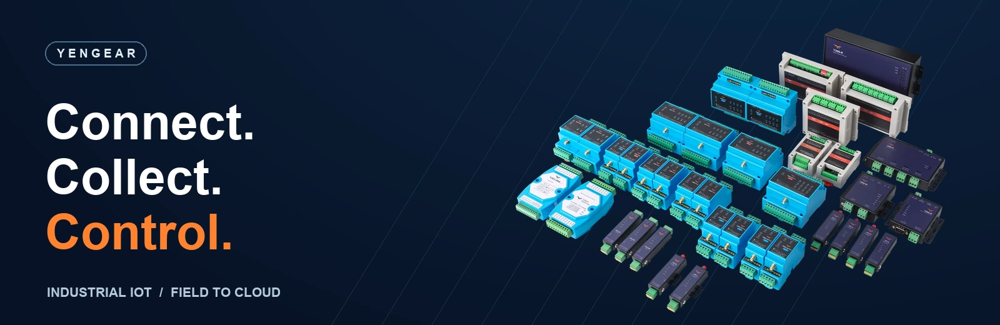

# YenGear

YenGear builds industrial IoT devices and solutions for connecting equipment, collecting field signals, and monitoring and controlling systems remotely.

**[Website](https://www.yengear.com/)** &nbsp; | &nbsp; **[Documentation](https://docs.yengear.com/)** &nbsp; | &nbsp; **[Online Store](https://store.yengear.com/)** &nbsp; | &nbsp; **[Contact](https://www.yengear.com/feedback/)**

## Products and platform

| Explore | What you'll find |
| --- | --- |
| [Wireless I/O Modules](https://www.yengear.com/products/wireless-io-modules/) | LoRa wireless links for digital and analog signals. |
| [Serial I/O Modules](https://www.yengear.com/products/io-module/) | Digital and analog I/O for RS485 Modbus RTU. |
| [Serial Gateways](https://www.yengear.com/products/serial-gateway/) | Connect serial equipment using cellular, Ethernet, Wi-Fi or LoRa, depending on the model. |
| [LoRaWAN Products](https://www.yengear.com/products/lorawan/) | Gateways, serial DTUs and I/O RTUs. |
| [Field-Ready Products](https://www.yengear.com/field-ready-products/) | Control cabinets, data loggers and alarm systems for field applications. |
| [YenGear IoT Cloud](https://www.yengear.com/iot-cloud/) | Dashboards, alerts, remote commands and API integration for connected equipment. |

## Developer resources

- **[Product documentation](https://docs.yengear.com/)** — manuals and technical resources for YenGear products.
- **[IoT Cloud Open API](https://docs.yengear.com/open-api-v2/)** — API reference for organization, project, device and data workflows.
- **[Online Serial Monitor](https://www.yengear.com/tools/serial-monitor/)** — send and inspect serial data in a supported desktop browser. Requires Web Serial support and permission to access a serial port.

## See the solutions in context

Explore applications for [greenhouse environmental control](https://www.yengear.com/applications/smart-greenhouse-environmental-control/), [wireless irrigation](https://www.yengear.com/applications/intelligent-irrigation-wireless-control/) and [industrial park monitoring](https://www.yengear.com/applications/industrial-park-environmental-monitoring-solution/), or browse [all applications](https://www.yengear.com/applications/).

## Get in touch

For product selection, integration or project questions, [tell us about your project](https://www.yengear.com/feedback/) or email [hi@yengear.com](mailto:hi@yengear.com).
